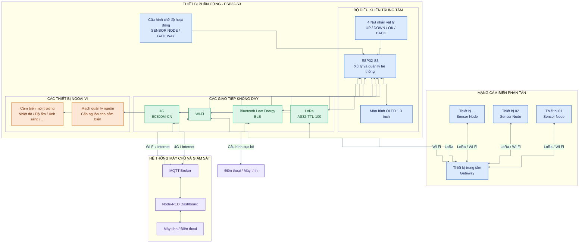
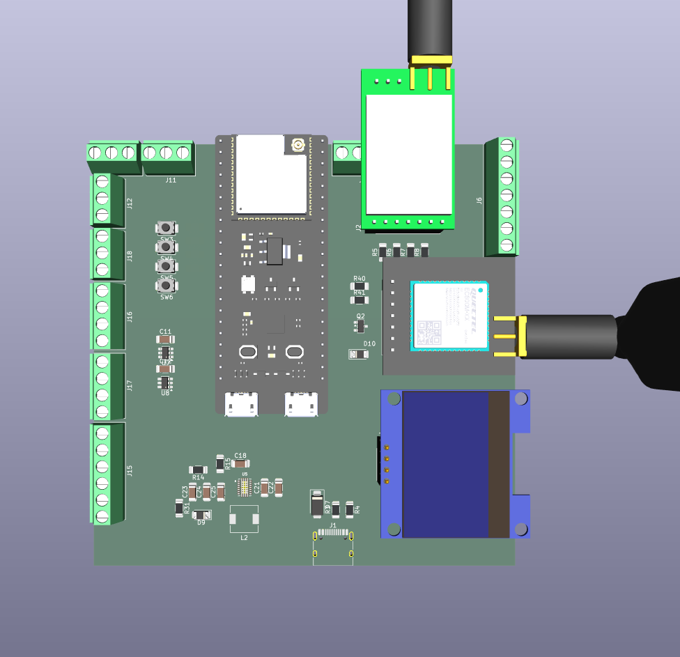
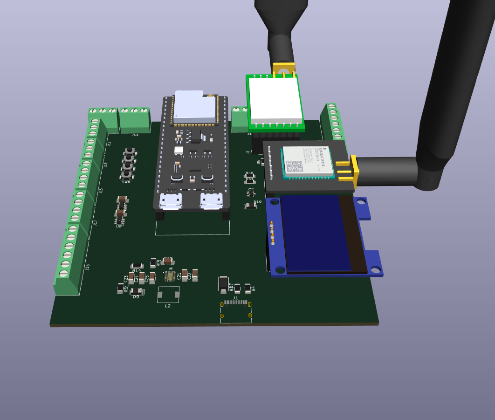
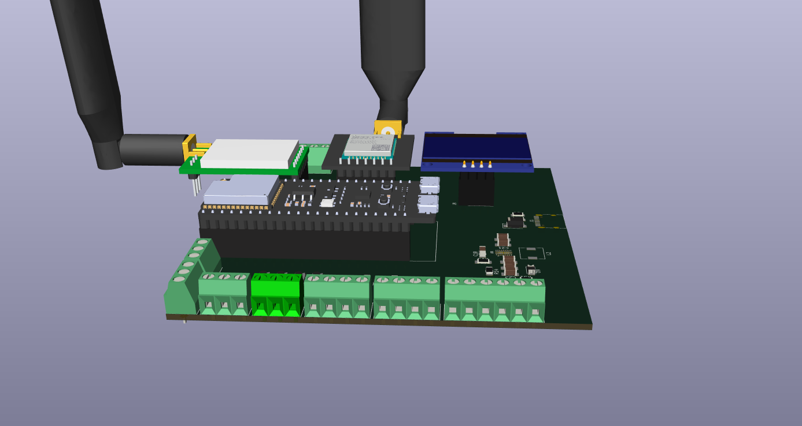
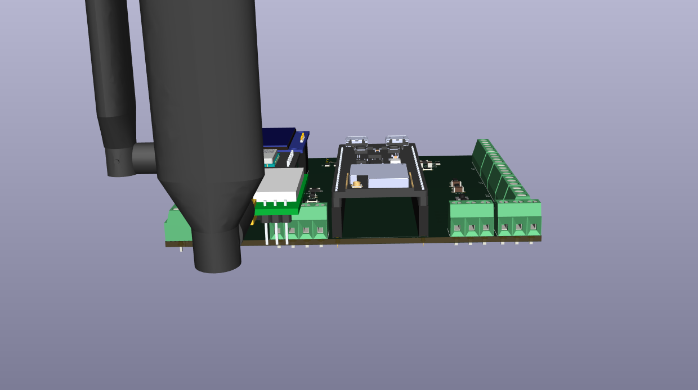
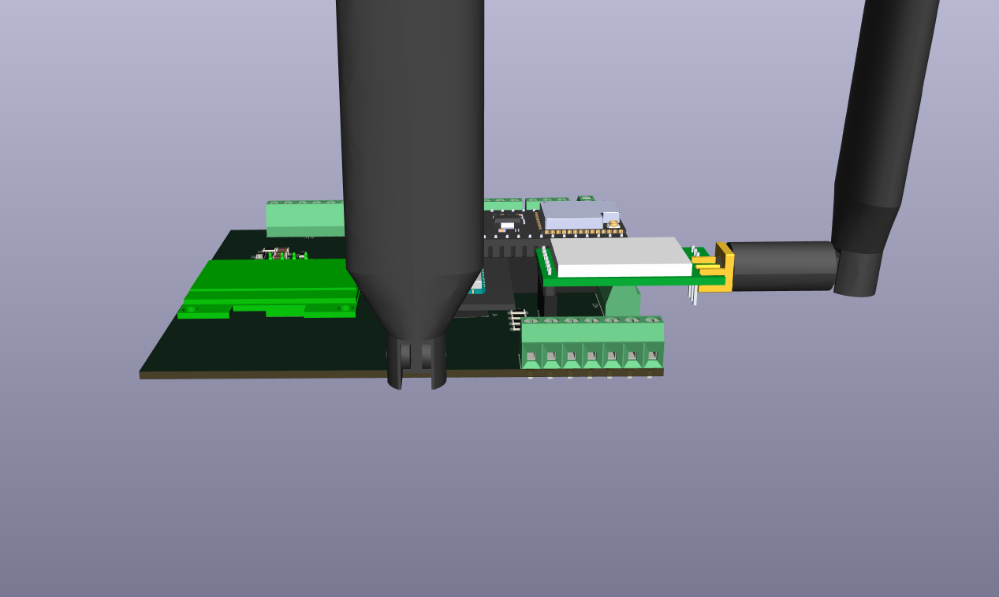

# Hệ thống mạng cảm biến IoT giám sát môi trường từ xa đa kết nối không dây

## 1. Thông tin đề tài
- **Tên đề tài:** Hệ thống mạng cảm biến IoT giám sát môi trường từ xa đa kết nối không dây
- **Môn học:** Phát triển ứng dụng IoT
- **Sinh viên thực hiện:** Ngô Anh Đức
- **Giảng viên môn học:** Nguyễn Anh Tuấn
- **Kho lưu trữ công khai (Public Repo):** 

## 2. Đặt bài toán và nhu cầu thực tế

### Các vấn đề tồn tại trong thực tế:

Trong các khu vực ngoài trời có diện tích rộng như trang trại, vườn cây, khu vực canh tác nông nghiệp hoặc khu vực sinh thái, việc theo dõi các thông số môi trường đóng vai trò quan trọng trong quá trình quản lý và vận hành. Tuy nhiên, việc giám sát tại những khu vực này vẫn tồn tại một số hạn chế:

- **Khó khăn trong giám sát diện rộng:** Các vị trí cần đo thường phân bố cách xa nhau, gây khó khăn cho việc thu thập dữ liệu tập trung.
- **Hạn chế về kết nối không dây:** Wi-Fi có phạm vi phủ sóng tương đối hạn chế, không đáp ứng tốt nhu cầu truyền dữ liệu tại những khu vực rộng hoặc cách xa hạ tầng mạng.
- **Phụ thuộc vào việc kiểm tra thủ công:** Người quản lý phải trực tiếp đến từng vị trí để kiểm tra và ghi nhận thông số môi trường, gây tốn thời gian và nhân lực.
- **Thiếu dữ liệu cập nhật liên tục:** Việc thu thập dữ liệu không thường xuyên khiến người quản lý khó phát hiện kịp thời những thay đổi bất thường của môi trường.
- **Khó khăn trong quản lý tập trung:** Dữ liệu từ nhiều vị trí chưa được tổng hợp và hiển thị trên một nền tảng thống nhất, gây bất tiện trong quá trình theo dõi và phân tích.

### Mục tiêu giải pháp:

Xây dựng hệ thống mạng cảm biến IoT có khả năng thu thập, truyền tải và giám sát các thông số môi trường ngoài trời từ xa, thông qua việc kết hợp nhiều công nghệ truyền thông không dây.

Các mục tiêu cụ thể bao gồm:

- **Thu thập dữ liệu phân tán:** Sử dụng nhiều nút cảm biến để đo các thông số môi trường như nhiệt độ, độ ẩm, cường độ ánh sáng và chất lượng không khí tại các vị trí khác nhau.
- **Truyền thông tầm xa:** Thiết lập mạng đa kết nối không dây giữa các nút cảm biến và Gateway, giảm sự phụ thuộc vào hạ tầng Wi-Fi.
- **Giám sát tập trung thông qua MQTT:** Sử dụng MQTT Broker làm trung gian trao đổi dữ liệu giữa Gateway và hệ thống giám sát.
- **Tối ưu năng lượng hoạt động:** Áp dụng cơ chế quản lý nguồn cho các cảm biến và thiết bị ngoại vi nhằm giảm điện năng tiêu thụ.

## 3. Tổng quan dự án

Dự án hướng đến xây dựng một hệ thống mạng cảm biến IoT phục vụ giám sát môi trường ngoài trời từ xa. Hệ thống sử dụng một nền tảng phần cứng thống nhất, có khả năng cấu hình và chuyển đổi giữa hai chế độ hoạt động: Sensor Node (nút cảm biến) và Gateway (bộ thu thập dữ liệu trung tâm).

Tùy theo chế độ được cấu hình, thiết bị sẽ đảm nhiệm các chức năng khác nhau:

- **Chế độ Sensor Node:** Thiết bị thu thập các thông số môi trường như nhiệt độ, độ ẩm, cường độ ánh sáng và chất lượng không khí thông qua các cảm biến được kết nối. Dữ liệu sau khi thu thập được truyền không dây đến Gateway.
- **Chế độ Gateway:** Thiết bị tiếp nhận dữ liệu LoRa từ các Sensor Node, xử lý và chuyển tiếp dữ liệu lên Internet. Đồng thời, Gateway có thể hiển thị thông tin tại chỗ và quản lý hoạt động của các thiết bị ngoại vi.

Ở phía máy chủ, hệ thống sử dụng MQTT Broker làm trung gian truyền nhận dữ liệu giữa Gateway và nền tảng giám sát. Node-RED được sử dụng để xây dựng giao diện Dashboard, cho phép người dùng theo dõi các thông số môi trường, quan sát sự thay đổi của dữ liệu và nhận cảnh báo khi các giá trị vượt ngưỡng cài đặt thông qua máy tính hoặc điện thoại.

- **Tự động phát hiện và đăng ký nút cảm biến mới (Automatic Node Discovery):** Cho phép Gateway tự động nhận diện và quản lý các Sensor Node mới thông qua cơ chế đăng ký mạng LoRa. Khi bổ sung thiết bị, người dùng không cần cấu hình lại hoặc nạp lại firmware cho Gateway, giúp đơn giản hóa quá trình triển khai và mở rộng mạng cảm biến.

Ngoài chức năng giám sát, dự án còn tích hợp các tính năng bổ sung:

- **Giao diện điều khiển cục bộ (Local User Interface):** Tích hợp màn hình OLED 1.3 inch cùng bốn nút nhấn UP, DOWN, OK và BACK, cho phép người dùng thao tác trực tiếp trên thiết bị để truy cập menu, lựa chọn chế độ hoạt động, cấu hình các thông số và theo dõi trạng thái hệ thống mà không cần sử dụng điện thoại hoặc máy tính.
- **Quản lý năng lượng:** Tối ưu điện năng tiêu thụ thông qua cơ chế quản lý nguồn cho cảm biến và các thiết bị ngoại vi.
- **Khả năng mở rộng:** Cho phép triển khai nhiều thiết bị sử dụng cùng một nền tảng phần cứng, cấu hình linh hoạt theo vai trò Sensor Node hoặc Gateway.

Thông qua mô hình này, dự án hướng đến một hệ thống giám sát môi trường phân tán, có khả năng mở rộng, linh hoạt trong triển khai và quản lý dữ liệu tập trung từ xa.

## 4. Sơ đồ khối hệ thống (System Architecture)

## 5. Tính năng kỹ thuật

### 5.1. Nền tảng phần cứng đa chế độ

- Sử dụng ESP32-S3 làm bộ điều khiển trung tâm trên một nền tảng phần cứng thống nhất.
- Hỗ trợ hai chế độ hoạt động: Sensor Node và Gateway, có thể lựa chọn thông qua giao diện cấu hình trên thiết bị.
- Cho phép sử dụng cùng một thiết kế phần cứng cho nhiều vai trò khác nhau trong mạng cảm biến.
- Lưu trữ các thông số cấu hình vào bộ nhớ không mất dữ liệu, đảm bảo duy trì thiết lập sau khi khởi động lại.

### 5.2. Kết nối không dây đa giao thức

- **Wi-Fi:** Kết nối với các thiết bị trong mạng nội bộ hoặc hạ tầng Wi-Fi có sẵn để trao đổi dữ liệu và truy cập Internet.
- **Bluetooth Low Energy (BLE):** Hỗ trợ kết nối trực tiếp với điện thoại hoặc máy tính để cấu hình và giám sát thiết bị ở khoảng cách gần.
- **LoRa:** Truyền dữ liệu không dây giữa các Sensor Node và Gateway ở khoảng cách xa.
- **4G:** Sử dụng mạng di động để đưa dữ liệu lên máy chủ thông qua Internet, phù hợp với các khu vực không có hạ tầng mạng cố định.

### 5.3. Tự động phát hiện và quản lý Node

- Hỗ trợ cơ chế tự động phát hiện và đăng ký Sensor Node mới vào mạng.
- Sử dụng mã định danh Node ID để phân biệt và quản lý từng thiết bị.
- Cho phép Gateway tiếp nhận dữ liệu từ các Node mới mà không cần nạp lại firmware hoặc cấu hình lại chương trình Gateway.
- Theo dõi trạng thái kết nối và quản lý danh sách các Node trong hệ thống.

### 5.4. Giao diện cấu hình và điều khiển cục bộ

- Tích hợp màn hình OLED 1.3 inch để hiển thị thông tin và trạng thái hoạt động của thiết bị.
- Sử dụng bốn nút nhấn UP, DOWN, OK và BACK để thao tác với hệ thống menu.
- Hỗ trợ lựa chọn chế độ hoạt động, cấu hình kết nối không dây và thiết lập thông số cảm biến.
- Cho phép kiểm tra thông tin thiết bị và trạng thái kết nối trực tiếp trên màn hình.
- Hỗ trợ cấu hình và giám sát thiết bị thông qua kết nối BLE.

### 5.5. Giám sát và quản lý dữ liệu qua Internet

- Sử dụng giao thức MQTT để truyền nhận dữ liệu giữa Gateway và máy chủ.
- Hỗ trợ kết nối với MQTT Broker thông qua Wi-Fi hoặc 4G.
- Sử dụng Node-RED để xây dựng giao diện Dashboard giám sát tập trung.
- Hiển thị thông số môi trường, trạng thái hoạt động và dữ liệu từ các Sensor Node.
- Hỗ trợ thiết lập ngưỡng cảnh báo khi các thông số môi trường vượt quá giá trị cho phép.
- Cho phép truy cập Dashboard thông qua máy tính và điện thoại có kết nối Internet.

### 5.6. Quản lý và tối ưu năng lượng

- Điều khiển nguồn cấp cho các cảm biến và thiết bị ngoại vi thông qua mạch quản lý nguồn.
- Hỗ trợ bật/tắt các khối phần cứng không cần thiết trong từng giai đoạn hoạt động.
- Cho phép thiết lập chu kỳ thu thập dữ liệu nhằm cân bằng giữa hiệu quả giám sát và mức tiêu thụ năng lượng.
- Định hướng hỗ trợ các chế độ tiết kiệm năng lượng để kéo dài thời gian hoạt động của thiết bị khi sử dụng nguồn pin.

## 5. Danh Mục Phần Cứng và Sơ Đồ Đấu Nối GPIO

### 6.1. Danh mục phần cứng 

| STT | Nhóm chức năng | Tên linh kiện / Module | Số lượng | Chức năng / Vai trò |
|:---:|---|---|:---:|---|
| 1 | Bộ điều khiển | ESP32-S3-DevKitC-1U-N8R8 | 1 | Bộ xử lý trung tâm, quản lý hoạt động và xử lý dữ liệu của hệ thống. |
| 2 | Truyền thông | AS32-TTL-100 | 1 | Module LoRa, truyền nhận dữ liệu không dây giữa các Node. |
| 3 | Truyền thông | Quectel EC800M-CN (TDM2519) | 1 | Cung cấp kết nối Internet thông qua mạng di động 4G. |
| 4 | Hiển thị | OLED 1.3 inch I2C | 1 | Hiển thị thông tin, trạng thái và giao diện cấu hình thiết bị. |
| 5 | Điều khiển | Nút nhấn vật lý (UP, DOWN, OK, BACK) | 4 | Thao tác với menu, lựa chọn và xác nhận các thông số cấu hình. |
| 6 | Cảm biến | Cảm biến nhiệt độ và độ ẩm | Theo cấu hình | Thu thập dữ liệu nhiệt độ và độ ẩm môi trường. |
| 7 | Cảm biến | Cảm biến ánh sáng | Theo cấu hình | Đo cường độ ánh sáng môi trường. |
| 8 | Cảm biến | Cảm biến chất lượng không khí | Theo cấu hình | Theo dõi các thông số liên quan đến chất lượng không khí. |
| 9 | Quản lý nguồn | IC nguồn TPS63020 | 1 | Chuyển đổi điện áp, cung cấp nguồn 3.3V cho các khối chức năng phù hợp. |
| 10 | Quản lý nguồn | IC Load Switch TPS22917 | Theo thiết kế | Điều khiển đóng/ngắt nguồn cấp cho các cảm biến và thiết bị ngoại vi. |
| 11 | Nguồn cấp | Cổng USB-C và nguồn ngoài | Theo cấu hình | Cung cấp nguồn điện cho hệ thống. |
| 12 | Phụ trợ | Anten LoRa | 1 | Hỗ trợ truyền nhận tín hiệu LoRa. |
| 13 | Phụ trợ | Anten 4G | 1 | Hỗ trợ kết nối mạng di động. |
| 14 | Phụ trợ | PCB và linh kiện điện tử | 1 bộ | Kết nối, phân phối nguồn và hoàn thiện thiết bị. |

**Lưu ý:** Danh mục trên là danh sách dự kiến. Số lượng và chủng loại cảm biến, module nguồn sẽ được cập nhật theo phần cứng thực tế được lựa chọn và triển khai.

### 6.2. Sơ đồ đấu nối GPIO

| Tên thiết bị / Chân nối | Chân GPIO | Chế độ cấu hình | Ý nghĩa chức năng |
|---|:---:|---|---|
| Cổng mở rộng IO1 | GPIO 1 | INPUT / OUTPUT | Chân GPIO đa dụng, phục vụ kết nối các thiết bị ngoại vi. |
| Cổng mở rộng IO2 | GPIO 2 | INPUT / OUTPUT | Chân GPIO đa dụng, phục vụ kết nối các thiết bị ngoại vi. |
| Kênh ADC1 – CH0 | GPIO 3 | INPUT (ADC) | Đọc tín hiệu điện áp analog từ cảm biến. |
| Kênh ADC1 – CH1 | GPIO 4 | INPUT (ADC) | Đọc tín hiệu điện áp analog từ cảm biến. |
| Kênh ADC2 – CH0 | GPIO 5 | INPUT (ADC) | Đọc tín hiệu điện áp analog từ cảm biến. |
| Kênh ADC2 – CH1 | GPIO 6 | INPUT (ADC) | Đọc tín hiệu điện áp analog từ cảm biến. |
| Tín hiệu CLK | GPIO 7 | OUTPUT | Xuất tín hiệu xung CLK cho thiết bị ngoại vi theo thiết kế. |
| Tín hiệu ON_1 | GPIO 8 | OUTPUT | Điều khiển bật/tắt thiết bị hoặc khối nguồn thứ nhất. |
| Tín hiệu ON_2 | GPIO 9 | OUTPUT | Điều khiển bật/tắt thiết bị hoặc khối nguồn thứ hai. |
| Tín hiệu OUT_CS | GPIO 10 | OUTPUT | Tín hiệu Chip Select, lựa chọn thiết bị ngoại vi trong giao tiếp SPI. |
| I2C0 – SDA | GPIO 11 | INPUT / OUTPUT (I2C) | Đường truyền dữ liệu của bus I2C thứ nhất. |
| I2C0 – SCL | GPIO 12 | OUTPUT (I2C) | Đường xung clock của bus I2C thứ nhất. |
| Cổng mở rộng IO14 | GPIO 14 | INPUT / OUTPUT | Chân GPIO đa dụng, phục vụ kết nối các thiết bị ngoại vi. |
| I2C1 – SCL | GPIO 15 | OUTPUT (I2C) | Đường xung clock của bus I2C thứ hai. |
| I2C1 – SDA | GPIO 16 | INPUT / OUTPUT (I2C) | Đường truyền dữ liệu của bus I2C thứ hai. |
| SPI – MISO | GPIO 17 | INPUT (SPI) | Nhận dữ liệu từ thiết bị ngoại vi qua giao tiếp SPI. |
| SPI – MOSI | GPIO 18 | OUTPUT (SPI) | Truyền dữ liệu đến thiết bị ngoại vi qua giao tiếp SPI. |
| Cổng mở rộng IO21 | GPIO 21 | INPUT / OUTPUT | Chân GPIO đa dụng, phục vụ kết nối các thiết bị ngoại vi. |
| Module 4G – SIM_TX | GPIO 38 | UART (RX) | ESP32-S3 nhận dữ liệu UART từ chân TX của module 4G. |
| Module 4G – SIM_RX | GPIO 45 | UART (TX) | ESP32-S3 truyền dữ liệu UART đến chân RX của module 4G. |
| Module LoRa – AUX | GPIO 46 | INPUT | Nhận tín hiệu trạng thái từ module LoRa, hỗ trợ kiểm tra trạng thái truyền nhận. |
| Module 4G – DTR | GPIO 47 | OUTPUT | Điều khiển tín hiệu DTR của module 4G. |
| Module 4G – PEN | GPIO 48 | OUTPUT | Điều khiển chân PEN của module 4G theo cấu hình phần cứng. |
| Module LoRa – ESP_RX_LORA_TX | GPIO 39 | UART (RX) | Nhận dữ liệu UART từ chân TX của module LoRa. |
| Module LoRa – ESP_TX_LORA_RX | GPIO 40 | UART (TX) | Truyền dữ liệu UART đến chân RX của module LoRa. |
| Module LoRa – MD1 | GPIO 41 | OUTPUT | Điều khiển chân chọn chế độ hoạt động MD1 của module LoRa. |
| Module LoRa – MD0 | GPIO 42 | OUTPUT | Điều khiển chân chọn chế độ hoạt động MD0 của module LoRa. |
| UART0 – TXD0 | GPIO 43 | UART (TX) | Truyền dữ liệu UART0, phục vụ debug hoặc giao tiếp nối tiếp. |
| UART0 – RXD0 | GPIO 44 | UART (RX) | Nhận dữ liệu UART0, phục vụ debug hoặc giao tiếp nối tiếp. |

### 6.3. Hình ảnh phần cứng mô phỏng

**Hình 1. Mô hình phần cứng nhìn từ trên xuống**

**Hình 2. Mô hình phần cứng nhìn nghiêng**

**Hình 3. Khu vực cổng kết nối thứ nhất**

**Hình 4. Khu vực cổng kết nối thứ hai**

**Hình 5. Khu vực cổng kết nối thứ ba**

## 7. Khả năng ứng dụng thực tế (Practical Applications)

Hệ thống có thể được triển khai trong nhiều môi trường khác nhau nhờ khả năng kết nối không dây đa giao thức và thiết kế phần cứng linh hoạt:

- **Giám sát môi trường ngoài trời:** Theo dõi môi trường tại các khu vực như công viên, khu dân cư và khuôn viên trường học.
- **Nông nghiệp thông minh:** Thu thập dữ liệu môi trường tại các khu vực canh tác, nhà kính và trang trại để hỗ trợ quản lý điều kiện sản xuất.
- **Giám sát tại khu vực thiếu hạ tầng mạng:** Sử dụng kết nối 4G để truyền dữ liệu lên máy chủ tại những nơi không có Wi-Fi.
- **Mở rộng hệ thống IoT:** Tận dụng nền tảng phần cứng đa chế độ để phát triển thêm các ứng dụng giám sát và thu thập dữ liệu khác.

## 8. Kế hoạch phát triển tương lai (Future Development)

- **Cập nhật firmware từ xa (FOTA):** Phát triển khả năng cập nhật firmware cho Gateway thông qua Internet và cho phép Gateway phân phối firmware đến các Sensor Node thông qua LoRa.
- **Tối ưu năng lượng:** Nghiên cứu các chế độ tiết kiệm năng lượng sâu hơn nhằm kéo dài thời gian hoạt động khi sử dụng pin.
- **Mở rộng mạng cảm biến:** Tăng số lượng Node, cải thiện khả năng quản lý và mở rộng phạm vi giám sát.
- **Tự động lựa chọn kết nối:** Phát triển cơ chế tự động lựa chọn hoặc chuyển đổi giữa Wi-Fi, LoRa và 4G tùy theo điều kiện kết nối.
- **Tăng cường bảo mật:** Bổ sung cơ chế xác thực thiết bị, mã hóa dữ liệu và bảo vệ quá trình truyền nhận.
